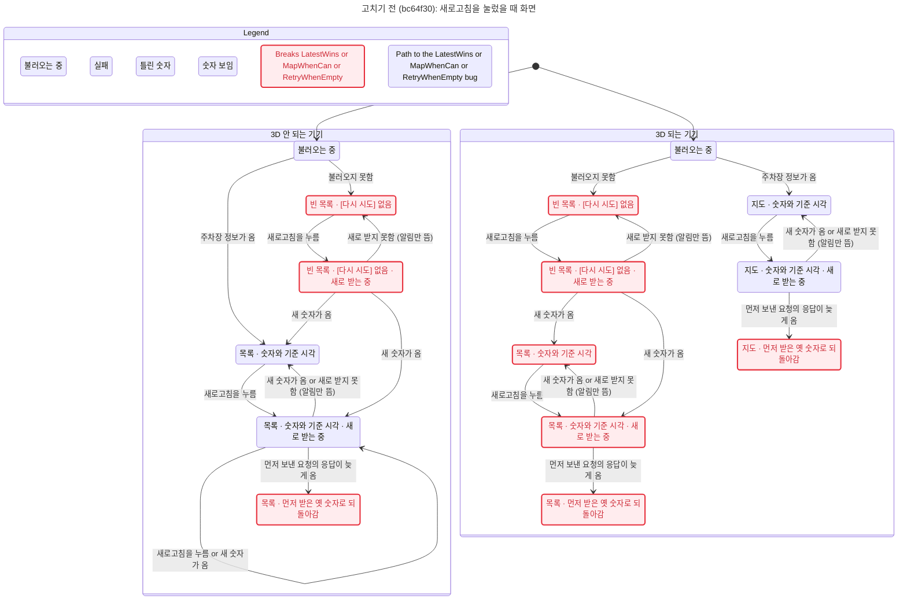
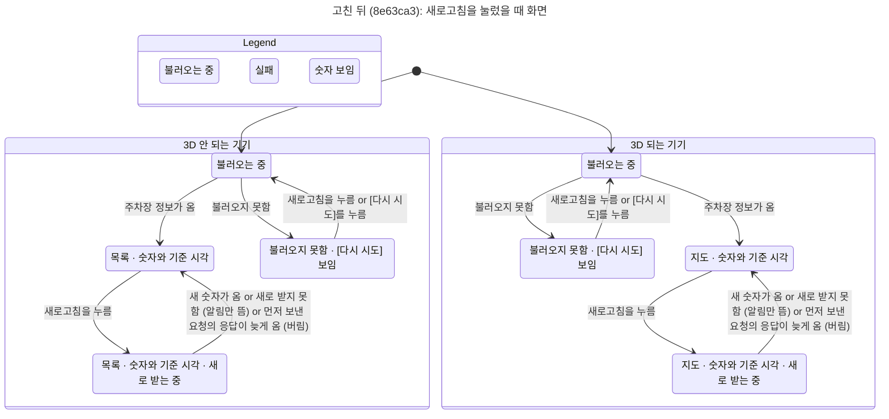

# 새로고침 동작: 고치기 전과 고친 뒤

기획 검토용 그림. 새로고침·다시 시도를 누르고 응답이 오가는 동안 사용자가 화면에서 무엇을 보는지 그렸다.
고치기 전은 `bc64f30`, 고친 뒤는 `8e63ca3`(PRD F7·F8에 적은 동작)이다.

## 지켜야 할 약속 네 개

| 그림의 이름 | 약속 | 고치기 전 | 고친 뒤 |
|---|---|---|---|
| `LatestWins` | 새로고침을 연달아 눌러도 화면 숫자는 마지막으로 보낸 요청의 응답이다. 늦게 온 옛 응답으로 되돌아가지 않는다. | 깨짐 | 지킴 |
| `NoWipe` | 불러오기 실패가 이미 보이는 숫자를 지우지 않는다. | 지킴 | 지킴 |
| `RetryWhenEmpty` | 숫자가 하나도 없고 불러오는 중도 아니면 [다시 시도]가 보이고 눌린다. | 깨짐 | 지킴 |
| `MapWhenCan` | 숫자를 받으면 3D 지도를 그리는 기기는 지도로 보인다. | 깨짐 | 지킴 |

그림 읽는 법: 빨간 테두리·빨간 글자 상자는 약속이 깨진 화면, 파란 테두리는 그 화면까지 가는 가장 짧은 길 위의 화면이다.
상자 바탕색은 단계(불러오는 중·실패·숫자 보임·틀린 숫자)다. "새로 받는 중"은 새로고침 응답을 기다리는 동안 숫자 옆 새로고침 버튼이 도는 상태다.

## 고치기 전 (bc64f30)





어느 화면이 어느 약속을 깨나:

- "빈 목록 · [다시 시도] 없음"(두 기기 모두, 새로 받는 중 포함): `RetryWhenEmpty`. 처음 불러오기에 실패하면 목록이 비고, 지도 위의 [다시 시도]를 목록이 덮어 누를 수 없다. 남는 길은 새로고침뿐이다.
- 3D 되는 기기의 "목록 · 숫자와 기준 시각"(새로 받는 중 포함): `MapWhenCan`. 실패 뒤 새로고침으로 숫자를 받아도 지도를 만들지 않아 3D 기기가 목록에 갇힌다.
- "… · 먼저 받은 옛 숫자로 되돌아감": `LatestWins`. 3D 되는 기기의 목록 쪽은 `MapWhenCan`도 깨진다.

가장 짧은 길(TLC 보고 번호 그대로):

- `RetryWhenEmpty` — 0. 3D 안 되는 기기 / 불러오는 중 → 1. 불러오지 못함: 빈 목록 · [다시 시도] 없음
- `MapWhenCan` — 0. 3D 되는 기기 / 불러오는 중 → 1. 불러오지 못함: 빈 목록 · [다시 시도] 없음 → 2. 새로고침을 누름: … · 새로 받는 중 → 3. 새 숫자가 옴: 목록 · 숫자와 기준 시각
- `LatestWins` — 0. 3D 안 되는 기기 / 불러오는 중 → 1. 주차장 정보가 옴: 목록 · 숫자와 기준 시각 → 2. 새로고침을 누름 → 3. 새로고침을 누름(둘 다 새로 받는 중) → 4. 새 숫자가 옴(나중 요청) → 5. 먼저 보낸 요청의 응답이 늦게 옴: 목록 · 먼저 받은 옛 숫자로 되돌아감

## 고친 뒤 (8e63ca3)





- 처음 불러오기에 실패하면 목록 자리에 "주차장 정보를 불러오지 못했습니다"와 [다시 시도]가 보인다. 이때 새로고침도 [다시 시도]와 같아서 둘 다 "불러오는 중"으로 돌아가 처음 시작을 다시 한다. 그래서 받은 뒤 3D 기기는 지도로 간다.
- 새로고침 중에 먼저 보낸 요청의 응답이 늦게 오면 버린다. 그림에서는 "새로 받는 중"에서 숫자 화면으로 돌아가는 화살표에 합쳐져 있다. 되돌아가는 화면이 없다.
- 새로고침이 실패하면 알림만 뜨고 보던 숫자는 그대로다.

## 그림에 없는 것

- 사람이 누르는 횟수는 2번까지만 그렸다(새로고침·다시 시도 합쳐). 세 약속이 깨지는 길은 모두 2번 안에 있다. 5번까지는 `../RefreshOrder.tla`(`node formal/refresh-order/check.mjs`)가 본다.
- 숫자의 내용(빈자리, 기준 시각, 오래됨 20분, 실시간 정보 없음), 알림 문구, 지도 이동·목록/지도 전환·검색·상세는 그리지 않았다.
- 지도 타일을 받는 시간은 "주차장 정보가 옴" 한 걸음에 묶었다.
- 숨긴 걸음: 더 누르지 않고 응답도 다 온 끝 상태의 "아무 일 없음" 한 가지뿐이다(제자리 걸음이라 원래 화살표가 없다).

## 실제 코드에서 확인

그림의 버그 길 세 개를 두 커밋의 `index.html`에서 브라우저로 한 걸음씩 재현했다. 응답은 실제 스냅샷(`data/parkings.json`)의 앞 10·20·30개 행이라 목록 칸 수로 어느 응답이 그려졌는지 안다.

```sh
node formal/refresh-order/statechart/replay.mjs   # design-harness의 playwright-core, Chrome, unpkg 접속 필요
```

- `bc64f30`: 실패 뒤 [다시 시도]가 화면 어디에도 눌리지 않음, 3D 기기가 숫자를 받고도 목록(지도 없음), 30칸을 받은 뒤 늦은 응답으로 20칸으로 되돌아감. 세 개 모두 일어난다.
- `8e63ca3`: 같은 순서에서 [다시 시도]가 보이고, 3D 기기는 지도로 가고, 30칸 그대로다.

## 다시 만들기

pstack `/statechart`의 `scripts/statechart`(Node 22.18+ 또는 23.6+, Java 11+)로 저장소 루트에서:

```sh
S=<pstack 플러그인>/skills/statechart/scripts/statechart
CHART_TITLE="고치기 전 (bc64f30): 새로고침을 눌렀을 때 화면" $S formal/refresh-order/statechart/RefreshScreen.tla \
  --config formal/refresh-order/statechart/before.cfg --view formal/refresh-order/statechart/view.mjs --out /tmp/chart-before
CHART_TITLE="고친 뒤 (8e63ca3): 새로고침을 눌렀을 때 화면" $S formal/refresh-order/statechart/RefreshScreen.tla \
  --config formal/refresh-order/statechart/after.cfg --view formal/refresh-order/statechart/view.mjs --out /tmp/chart-after
```

TLC가 없으면 `TLA2TOOLS=~/.cache/tla/tla2tools-1.7.4.jar JAVA=$(which java)`를 붙인다. SVG는 `pele@1.9.0`의 `render`로 만들고 pstack statechart의 `references/render.md` 색을 넣었다.
