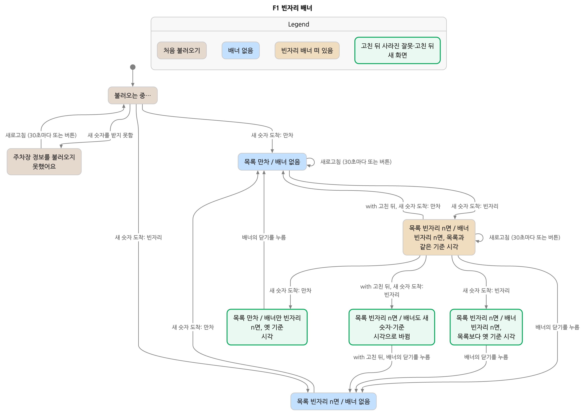
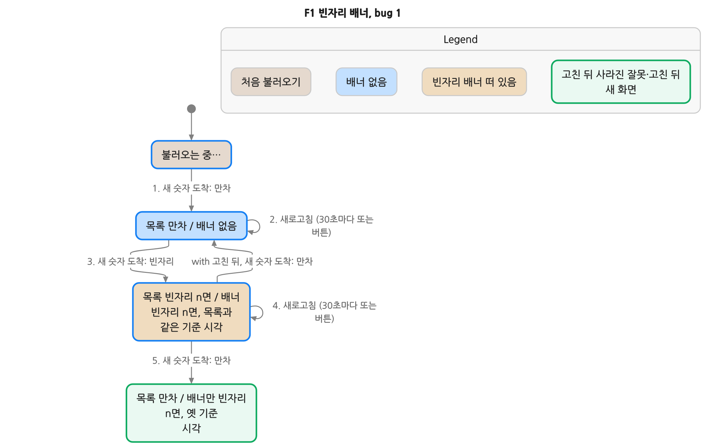
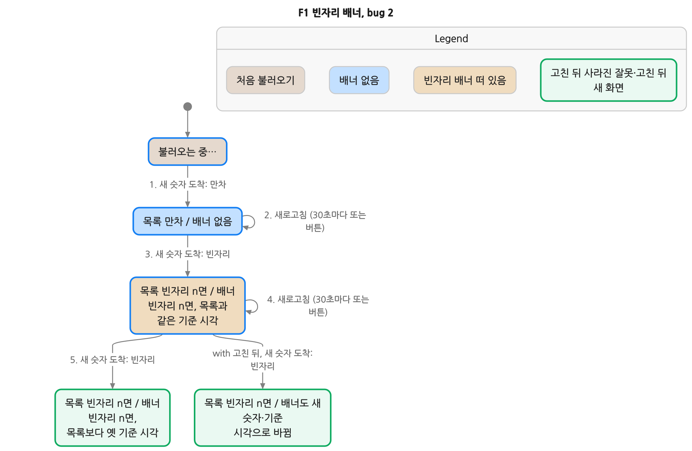

# F1 그림: 빈자리 배너가 옛 숫자에 남던 문제

즐겨찾기한 주차장이 만차였다가 빈자리가 생기면 화면 위에 빈자리 배너가 뜹니다(PRD F10). F1은 배너를 띄운 뒤 새 숫자가 와도 배너만 처음 숫자에 남던 문제입니다. 지금은 고쳤습니다(커밋 `79bd5aa`).

그림 속 말은 휴대폰 화면에 보이는 그대로입니다. 상자 하나가 화면 하나이고, `목록 … / 배너 …`는 즐겨찾기 주차장의 목록 숫자와 빈자리 배너를 뜻합니다. 화살표는 그 화면을 바꾸는 일입니다. "n면"은 1면 이상인 빈자리 수입니다.

## 전체 그림 — `chart/chart.png`



- 회색·파랑·노랑 상자: 고치기 전과 고친 뒤에 똑같이 보이는 화면.
- 초록 상자: 고치기 전에만 있던 잘못된 화면이거나, 고친 뒤에 새로 생긴 화면.
- `with 고친 뒤, …` 화살표: 고친 뒤에만 일어나는 일.

## 고치기 전에 생기던 잘못 두 가지

### 1. 목록은 만차인데 배너만 빈자리 — `chart/bug-1.png`



1. 처음 불러온 숫자: 만차 → 목록 만차, 배너 없음
2. 새로고침(30초마다 또는 버튼)
3. 새 숫자 도착: 빈자리 → 목록 빈자리 n면, 빈자리 배너가 뜸
4. 새로고침
5. 새 숫자 도착: 만차 → **고치기 전**: 목록은 만차인데 배너는 아직 "빈자리 n면 · (이전 시각) 기준". **고친 뒤**: 배너를 내려서 목록 만차, 배너 없음.

### 2. 목록과 배너의 빈자리 수가 다름 — `chart/bug-2.png`



1~4는 위와 같습니다.

5. 새 숫자 도착: 빈자리(수가 바뀜) → **고치기 전**: 목록은 새 숫자와 새 기준 시각인데 배너는 처음 숫자와 이전 기준 시각에 남음. **고친 뒤**: 배너도 목록과 같은 숫자와 기준 시각으로 바뀜.

두 경우 모두 사용자가 배너를 닫으면 배너 없는 화면으로 돌아갑니다. 고친 뒤에는 실시간 정보 없음이 되거나 응답에 그 주차장이 빠져도 배너를 내립니다(이 그림은 그 경우를 따로 그리지 않음).

## 확인한 것

- 형식 검증(TLC): 고치기 전 모델은 약속 3 "배너 숫자도 목록과 같은 최신 응답에서 나온다"(`BannerLatest`)를 깨고, 고친 뒤 모델은 깨지 않습니다. 약속 1(`ScreenLatest`)·약속 2(`NotifyOnce`)는 두 모델 모두 지킵니다. 모델 상태 110,518개, 그림 상태 8개·화살표 16개(`chart/summary.json`). 사용자가 보는 단계 5개, 모델 단계 19개.
- 실제 화면으로 재현: `replay-f1.mjs`가 `tests/harness.mjs`로 `index.html`을 그대로 돌려 위 순서를 따라갑니다. 숫자는 `data/parking.json`의 방화역(동) 실제 행(총 67면)에서 주차 대수만 66대·65대로 바꾸고, 기준 시각은 실제 행 시각(07:55)에서 1분·2분 뒤로 둡니다.

  | 코드 | 버그 1: 5 뒤 목록 / 배너 | 버그 2: 5 뒤 목록 / 배너 |
  |---|---|---|
  | 고치기 전 `6ad910d` | 만차 07:57 / **1면 · 07:56** | 2면 07:57 / **1면 · 07:56** |
  | 고친 뒤 `2903b98` | 만차 07:57 / 없음 | 2면 07:57 / 2면 · 07:57 |

## 그림이 빼는 것

- 빈자리 수는 0(만차)과 1면 이상 두 가지로만 봅니다. 그래서 "n면"으로 씁니다.
- 즐겨찾기 주차장 1곳, 불러오기 3번, Open API 숫자 3번까지 봅니다(`run.sh`는 4번까지). 즐겨찾기 끄기, 20분 넘은 숫자, 실시간 정보 없음, 상세 화면, "새 정보를 불러오지 못했어요" 띠는 그리지 않습니다.
- 서버 저장·Open API 응답·늦게 온 앞 응답 버리기처럼 화면이 그대로인 단계는 그림에서 숨기고 `chart/stories.md`에만 적었습니다.

## 다시 만들기

```
verify/refresh-order/f1-chart/make.sh                 # 그림(chart/). pstack statechart 스킬, TLA+ tools 1.7.4, Java 필요
node verify/refresh-order/f1-chart/replay-f1.mjs      # 지금 코드로 순서 재현
```

`before/`·`fixed/`의 `RefreshOrder.tla`는 같은 파일이고 `.cfg`의 `RefreshBanner`만 다릅니다(FALSE = 고치기 전). `verify/refresh-order/RefreshOrder.tla`와 비교해 그림을 위해 바꾼 곳:
- `bannerKept` 변수: 배너가 새 숫자로 바뀐 화면을 따로 그리려고 더했습니다. 동작은 바꾸지 않습니다.
- Open API 숫자 변화를 `AdvanceFull`(만차가 됨)·`AdvanceOpen`(빈자리 생김)으로 나누고, 아직 오지 않은 숫자는 그때 고릅니다. 어떤 동작도 아직 오지 않은 숫자를 읽지 않아 같은 행동입니다. 이렇게 해야 고친 뒤 되짚기가 같은 숫자를 따라갑니다.
- `Next`의 응답 받기를 `\E k, v : Receive(k, v)`로 써서 단계 이름이 붙게 했고, `OtherArrive` 조건에 `server/index.mjs` 줄을 달았습니다.
